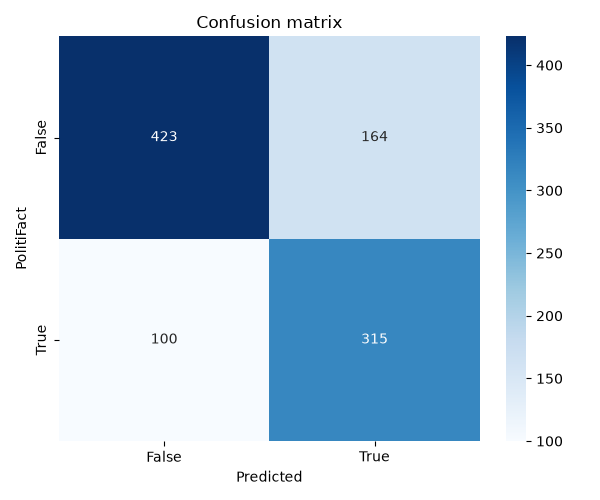

# SearchAPI

Give it a claim; it searches the web, reads the evidence and returns a **True / False verdict with its reasoning**.

SearchAPI is the retrieval-and-verdict prototype behind [FACTUAL](https://ruchirjadhav.dev/projects/factual), a real-time speech fact-checking project. It runs on its own as a batch tool: point it at a file of claims and it produces structured JSON you can inspect and score.

## How it works

```
claim ─► Google Custom Search ─► download + summarise pages ─► keep the best 6 ─► Gemini ─► verdict JSON
          (up to 10 results)      (newspaper3k)                (longest summaries)   (claim + summaries only)
```

1. **Search.** Google Programmable Search returns up to 10 pages for the claim.
2. **Read.** Each page is downloaded and reduced to a short extractive summary.
3. **Filter.** Summaries under 200 characters are dropped; the six longest are kept.
4. **Verify.** Gemini sees the claim and those summaries only, and answers in a fixed format: verdict, collective summary, reasoning, per-source notes. The reply is parsed into JSON.
5. **Save.** Results are written after every few claims with a checkpoint, so an interrupted run resumes where it stopped and failed claims are retried next time.

## Quick start

Tested on Python 3.14.

```bash
python -m venv .venv
source .venv/bin/activate          # Windows: .venv\Scripts\activate
pip install -r requirements.txt
cp .env.example .env               # then fill in the three keys
python batch_fact_verifier.py --start 0 --end 20
```

You need three credentials in `.env`:

| Variable | Where to get it |
| --- | --- |
| `GEMINI_API_KEY` | [Google AI Studio](https://aistudio.google.com/apikey) |
| `GOOGLE_API_KEY` | Google Cloud, with the Custom Search API enabled |
| `GOOGLE_CSE_ID` | [Programmable Search Engine](https://programmablesearchengine.google.com/), set to search the entire web |

The free Custom Search quota is small (roughly 100 queries a day at the time of writing; check Google's current limits), so start with a small range.

### Options

| Flag | Default | Meaning |
| --- | --- | --- |
| `--start`, `--end` | `0`, `10` | Claim index range (end is exclusive) |
| `--workers` | `4` | Claims verified in parallel |
| `--model` | `gemini-2.0-flash` | Gemini model; also settable with `GEMINI_MODEL` |
| `--input` | `data/politifact_factcheck_data.json` | JSON-lines file with a `statement` field per line |
| `--output-dir` | `output` | Where results are written |
| `--delay` | `0.5` | Seconds between article downloads |

## Output

Written to `output/`:

| File | Contents |
| --- | --- |
| `parsed_output.json` | One entry per claim: `verdict`, `collective_summary`, `reasoning`, `sources_summary` |
| `full_output.json` | Gemini's raw reply for each claim |
| `fact_results.json` | The articles (title, URL, snippet, summary) each verdict was based on |
| `checkpoint.json` | Indices already verified |

## Evaluating against PolitiFact

```bash
python evaluate_accuracy.py
```

The committed results cover **1,096 of the dataset's 21,152 claims**. Of those, **1,002** received a clean True/False verdict (the rest were answers like "Mostly True" or "Cannot be determined", which the evaluation excludes). Scored against PolitiFact's own ratings:

| | precision | recall | F1 | claims |
| --- | --- | --- | --- | --- |
| False | 0.81 | 0.72 | 0.76 | 587 |
| True | 0.66 | 0.76 | 0.70 | 415 |

**Accuracy: 73.7%** on those 1,002 claims.



How to read this number:

- PolitiFact's six-point scale is collapsed to two classes: *true*, *mostly-true* and *half-true* count as True; *barely-true*, *false* and *pants-fire* count as False. Change it with `--true-labels`.
- The search is not restricted, so PolitiFact's own write-up of a claim can appear among the sources. The score therefore measures retrieval plus reading, not fully independent verification.
- This is the standalone prototype, not the benchmark reported for the full FACTUAL pipeline.

## Tests

```bash
pip install -r requirements-dev.txt
pytest
```

The tests replace Google, Gemini and the web with fakes, so they run offline and need no API keys. They cover the reply parser, article filtering, the batch run with checkpoint and resume, error logging, and the evaluation maths.

## Limitations

- Verdicts rest on short extractive summaries, not the full text of each article.
- Only True and False are supported; there is no "not enough evidence" outcome, and roughly 1 in 12 replies drifted from the requested format anyway.
- Needs live Google and Gemini access, and quotas limit how fast a large run can go.
- English-language, mostly US political claims.

## Data

`data/politifact_factcheck_data.json` is a public dump of PolitiFact fact-checks (JSON lines), included so the project runs out of the box. The ratings belong to PolitiFact; check their terms before reusing the data elsewhere.
